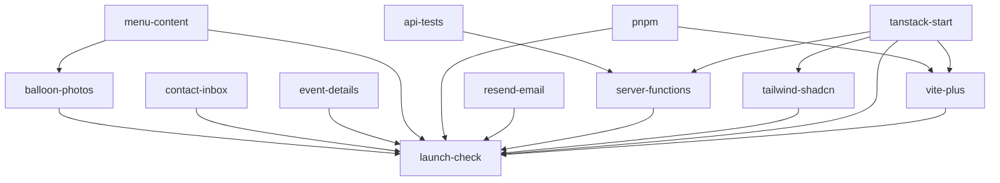

<!-- Generated by the tasks CLI. Edit tasks/ and run `tasks render`; never edit this file. -->

# Balloon x Bros launch — Tasks

The remaining work to take the live site (https://balloonxbros.com) from
placeholder content to a real launch for the KIMS fundraiser in late Nov 2026.
The site itself is built; see [DESIGN.md](DESIGN.md) for the spec and
[PLACEHOLDERS.md](PLACEHOLDERS.md) for every value still to fill in.

> **Progress log:** [progress.md](progress.md) records *how* each task is carried out. Read it before
> starting a task; log as you work with `tasks log <id> "…"`.

## Design

### Content: migrations first, then admin
- Launch content (event settings, menu, photo paths) lands as reviewed
  migrations, never by editing `0001_init.sql`. CI applies them before deploy.
- Each PR takes the **next free number** (`000N_<name>.sql`) at the time it
  opens, so parallel PRs don't collide.
- After launch, live changes (stock, toggling items, `orders_open`) happen only
  in `/admin`, and no later migration touches those rows. A migration
  overwrites admin edits.
- Each content PR removes the rows it filled from `PLACEHOLDERS.md`, so that
  file always lists exactly what's left.

### Email: two separate pieces
- **Inbound** — Cloudflare Email Routing forwards `hello@balloonxbros.com`
  (footer, and the reply-to of confirmation mail) to Li. Root-domain MX records.
- **Outbound** — Resend sends confirmation mail from
  `orders@balloonxbros.com` (`EMAIL_FROM`). DKIM plus SPF/MX on Resend's
  `send.` subdomain, so it doesn't clash with routing. Until
  `RESEND_API_KEY` is set the Worker skips sending.

### Pre-orders stay closed until launch
`orders_open` is turned off in `/admin` while content is placeholder. The
[launch check](tasks/launch-check.md) turns it back on as its last step.

### Stack migration (before launch, by decision)
- **pnpm** replaces npm; **Vite+** (`vp`) then wraps dev/build/test/lint.
- **TanStack Start** with SSR on Workers replaces the hand-rolled SPA router,
  in two steps: pages and routing first, with `/api/*` still served by the
  old handler, then the API moves to server functions and server routes.
- **Tailwind v4 + shadcn on Base UI** replaces `src/styles.css`. The
  DESIGN.md tokens become the theme, and the canvas stays the visual source of
  truth.
- One migration at a time where they share `package.json`, `vite.config.ts`
  or page files. The launch check runs on the final stack.

## Dependencies

## Tasks

**Legend:** `[ ]` todo · `[~]` doing · `[x]` done · `[-]` closed. Each task file's frontmatter is the source of truth; query with `tasks ready`, `tasks show <id>`.

- [ ] [Balloon photos](tasks/balloon-photos.md) — square photos in public/balloons/, photo_key set by migration · **waits on** `menu-content`
- [ ] [Contact inbox for hello@](tasks/contact-inbox.md) — Cloudflare Email Routing forwards hello@balloonxbros.com to Li
- [ ] [Real event details](tasks/event-details.md) — migration with date, time, place, cutoff, purpose, donation URL
- [ ] [Production launch check](tasks/launch-check.md) — end-to-end test order on prod, clean up, reopen pre-orders · **waits on** `event-details`, `menu-content`, `balloon-photos`, `contact-inbox`, `resend-email`, `server-functions`, `tailwind-shadcn`, `vite-plus`
- [ ] [Real menu, prices and stock](tasks/menu-content.md) — migration with real items, prices, limited stock; hide unused seed items
- [ ] [Resend confirmation email](tasks/resend-email.md) — verify domain in Resend, set RESEND_API_KEY, confirm delivery
- [ ] [API as server functions](tasks/server-functions.md) — move worker/ routes to Start server functions and server routes
- [ ] [Tailwind + shadcn (Base UI)](tasks/tailwind-shadcn.md) — Tailwind v4, shadcn on Base UI, DESIGN.md tokens as theme; restyle pages
- [ ] [Migrate to Vite+](tasks/vite-plus.md) — vp migrate; scripts and CI on vp check/test/build
- [x] [API route tests in the Workers runtime](tasks/api-tests.md) — route-level tests on local D1/R2 via @cloudflare/vitest-plugin; safety net for server-functions
- [x] [Switch to pnpm](tasks/pnpm.md) — pnpm lockfile, packageManager, CI, docs
- [x] [Migrate to TanStack Start (SSR)](tasks/tanstack-start.md) — file routes + SSR on Workers; /api/* still served by the existing handler
